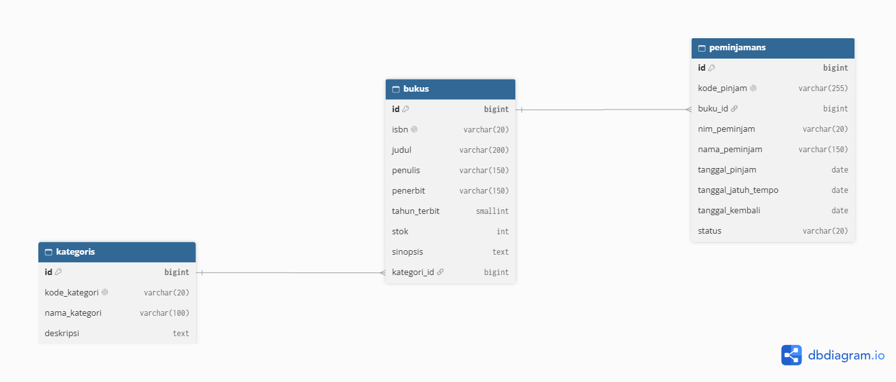
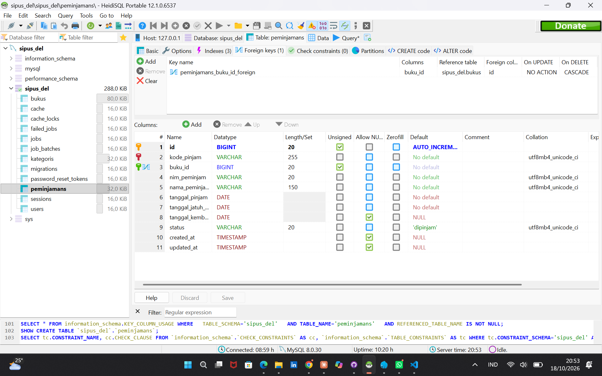
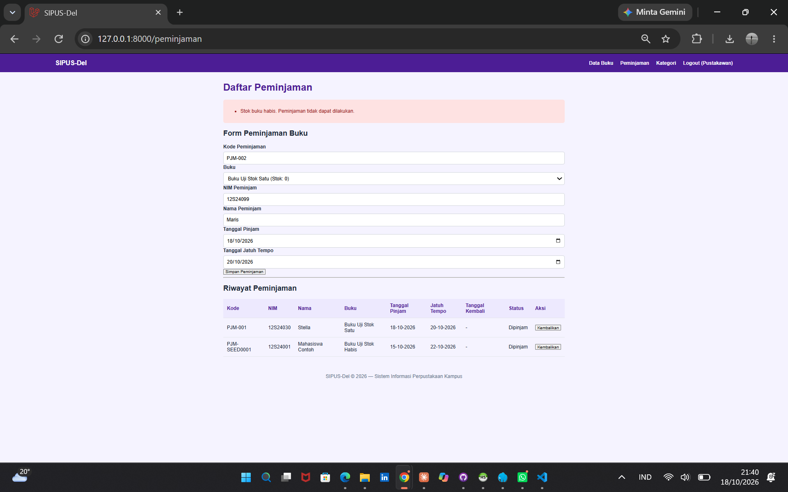
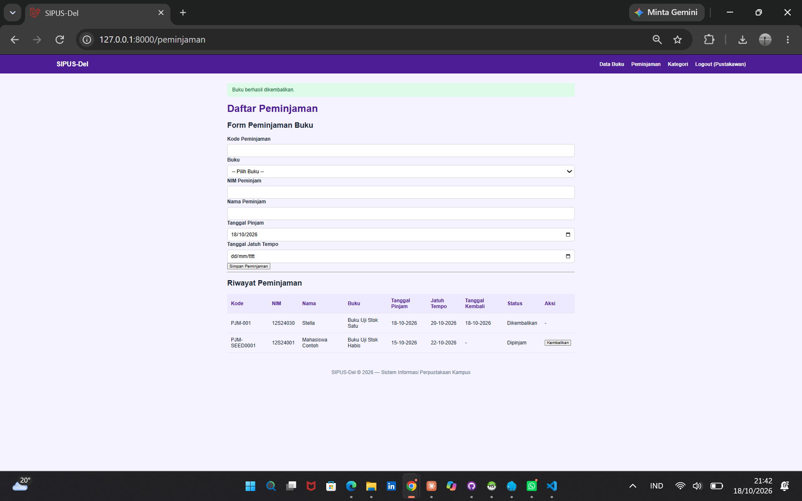
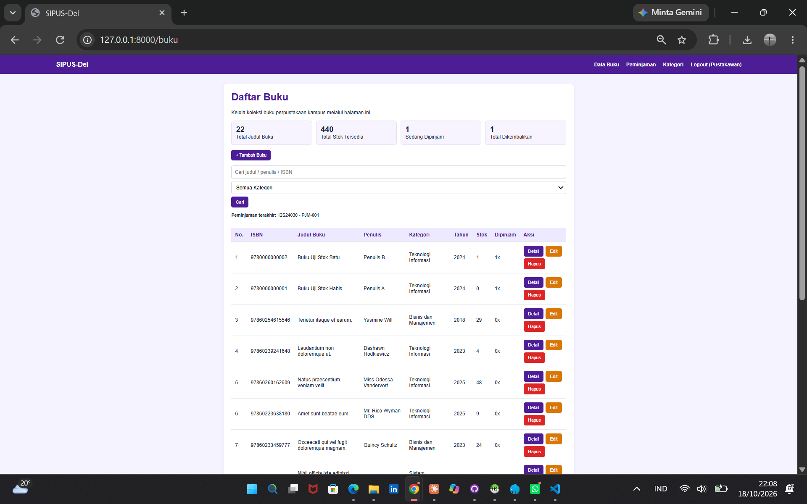
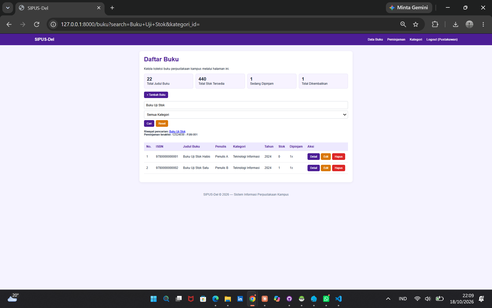
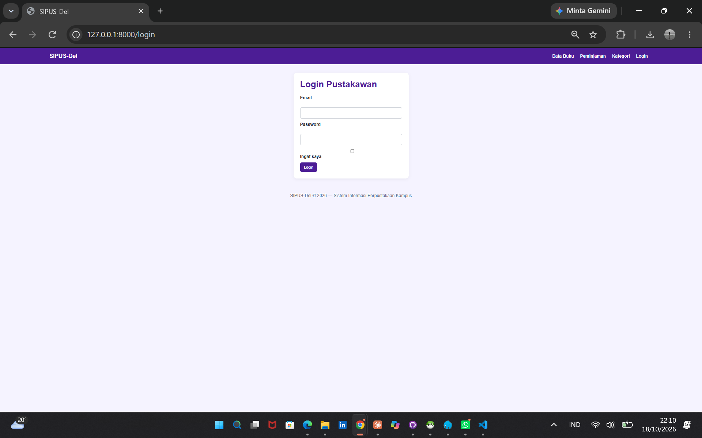
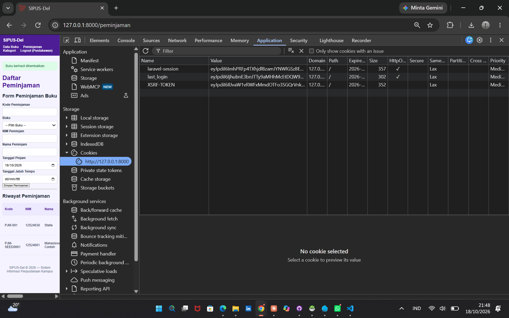

# SIPUS-Del Tahap 2
## Sistem Informasi Perpustakaan Kampus: Transaksi, Query Builder, Session, dan Autentikasi

SIPUS-Del adalah aplikasi web pengelolaan perpustakaan kampus berbasis Laravel dan MySQL. Tugas Minggu 6 (branch `week6-db-session`) melanjutkan proyek Minggu 5 dengan:

1. Tabel `peminjamans` dan relasi Eloquent ke `bukus`.
2. Transaksi ACID peminjaman dan pengembalian dengan `DB::transaction()` dan `lockForUpdate()`.
3. Rekapitulasi dengan Query Builder, `withCount`, dan filter dinamis.
4. Session, Cookie, dan autentikasi pustakawan.
5. Seeder akun uji dan data uji transaksi.

## 1. Teknologi

- PHP, Laravel 13
- MySQL (Laragon) dan HeidiSQL
- Blade, HTML, CSS
- Eloquent ORM dan Query Builder
- Composer, Git, GitHub

Catatan: Penugasan menyebut Laravel 11, namun pada kelas praktikum telah disepakati penggunaan Laravel 13.

## 2. Akun Uji

| Email | Password |
|---|---|
| pustakawan@del.ac.id | password123 |

Akun ini hanya untuk pengujian. Semua rute mutasi dan halaman peminjaman memerlukan login.

## 3. Cara Menjalankan

1. Clone dan pindah branch:
```bash
   git clone https://github.com/SwastiSihombing/ppw-2026-week5-12S24030.git
   cd ppw-2026-week5-12S24030
   git checkout week6-db-session
```
2. Instal dependensi: `composer install`
3. Salin environment: `Copy-Item .env.example .env`, lalu atur database (contoh Laragon):
```dotenv
   DB_CONNECTION=mysql
   DB_HOST=127.0.0.1
   DB_PORT=3306
   DB_DATABASE=sipus_del
   DB_USERNAME=root
   DB_PASSWORD=
```
4. Jalankan MySQL (Start All di Laragon). Database `sipus_del` bisa dibuat lewat HeidiSQL atau otomatis saat `php artisan migrate` menawarkannya.
5. Buat key: `php artisan key:generate`
6. Migrasi dan seeder: `php artisan migrate --seed`
7. Jalankan: `php artisan serve`, lalu buka http://127.0.0.1:8000

Seeder menyiapkan kategori dan buku contoh, akun pustakawan, *Buku Uji Stok Habis* (stok 0), *Buku Uji Stok Satu* (stok 1), serta sampel transaksi `PJM-SEED0001`.

## 4. Desain Database dan ERD

Tiga tabel utama: `kategoris`, `bukus`, dan `peminjamans`.

### Tabel `kategoris`
| Kolom | Tipe | Keterangan |
|---|---|---|
| id | Integer | Primary key |
| kode_kategori | String(20) | Unik |
| nama_kategori | String(100) | Nama kategori |
| deskripsi | Text, nullable | Deskripsi |
| timestamps | Timestamp | created_at, updated_at |

### Tabel `bukus`
| Kolom | Tipe | Keterangan |
|---|---|---|
| id | Integer | Primary key |
| isbn | String(20) | Unik |
| judul | String(200) | Judul buku |
| penulis | String(150) | Penulis |
| penerbit | String(150) | Penerbit |
| tahun_terbit | Unsigned small integer | Tahun terbit |
| stok | Unsigned integer | Default 0 |
| sinopsis | Text, nullable | Ringkasan |
| kategori_id | Foreign key | Mengacu ke `kategoris.id` |
| timestamps | Timestamp | created_at, updated_at |

### Tabel `peminjamans`
| Kolom | Tipe | Keterangan |
|---|---|---|
| id | Integer | Primary key |
| kode_pinjam | String | Unik |
| buku_id | Foreign key | Mengacu ke `bukus.id`, `cascadeOnDelete` |
| nim_peminjam | String(20) | NIM peminjam |
| nama_peminjam | String(150) | Nama peminjam |
| tanggal_pinjam | Date | Tanggal pinjam |
| tanggal_jatuh_tempo | Date | Batas pengembalian |
| tanggal_kembali | Date, nullable | Tanggal kembali |
| status | String | `dipinjam` atau `dikembalikan` (default `dipinjam`) |
| timestamps | Timestamp | created_at, updated_at |

### Relasi
- `Kategori` hasMany `Buku`; `Buku` belongsTo `Kategori`.
- `Buku` hasMany `Peminjaman`; `Peminjaman` belongsTo `Buku`.
- `peminjamans.buku_id` memakai `ON DELETE CASCADE`: riwayat peminjaman ikut terhapus saat bukunya dihapus.

### ERD


### Bukti Foreign Key `cascadeOnDelete`


## 5. Transaksi ACID dan Concurrency Locking

Peminjaman dan pengembalian dibungkus `DB::transaction()` pada `PeminjamanController`.

**Peminjaman (`store`)**
1. Baris buku dikunci dengan `Buku::whereKey($id)->lockForUpdate()->firstOrFail()`. Permintaan lain ke buku yang sama menunggu sampai transaksi selesai, sehingga stok tidak bisa minus akibat peminjaman bersamaan.
2. Jika `stok <= 0`, `ValidationException` dilempar dan transaksi di-rollback.
3. Jika NIM yang sama masih meminjam buku yang sama (status `dipinjam`), peminjaman ditolak.
4. Jika lolos, stok dikurangi dengan `decrement('stok')` dan data peminjaman dibuat.
5. `QueryException` ditangkap dan dicatat dengan `Log::error()`.

**Pengembalian (`kembalikan`)**
1. Baris peminjaman dikunci dengan `lockForUpdate()`.
2. Jika status sudah `dikembalikan`, proses ditolak.
3. Stok ditambah dengan `increment('stok')`, status menjadi `dikembalikan`, dan `tanggal_kembali` diisi.

### Bukti Pengujian

**Peminjaman berhasil (stok 1 menjadi 0)**


**Penolakan saat stok 0 (rollback, stok tidak minus)**



**Pengembalian buku (status Dikembalikan, stok bertambah)**



## 6. Query Builder, withCount, dan Filter Dinamis

Katalog pada `BukuController@index`:

```php
Buku::with('kategori')
    ->withCount('peminjamans')
    ->when($search, fn ($q, $s) => /* judul / penulis / ISBN */)
    ->when($kategoriId, fn ($q, $id) => $q->where('kategori_id', $id))
    ->latest()
    ->paginate(10)
    ->withQueryString();
```

- `with('kategori')` dan `withCount('peminjamans')` mencegah N+1 query.
- `when()` menerapkan filter hanya jika parameter diisi.
- `withQueryString()` menjaga kata kunci dan kategori saat berpindah halaman.
- Kartu statistik memakai `DB::table()`: `count()` total judul, `sum('stok')` total stok tersedia, serta `count()` pada `peminjamans` berstatus `dipinjam` dan `dikembalikan`.





## 7. Session, Cookie, dan Autentikasi

`AuthController` menangani login dan logout pustakawan:

- Login: `Auth::attempt()`, lalu `$request->session()->regenerate()` (mencegah session fixation) dan `Cookie::queue('last_login', ...)`.
- Logout: `Auth::logout()`, `session()->invalidate()`, dan `regenerateToken()`.
- Middleware `guest` pada halaman login; middleware `auth` pada seluruh rute mutasi (create, store, edit, update, destroy untuk buku dan kategori, serta peminjaman dan pengembalian). Katalog dan detail buku bersifat publik.
- State pengguna: Session menyimpan `riwayat_pencarian` dan `peminjaman_terakhir`; Cookie `last_search` dibuat dengan `Cookie::queue()`.



### Audit Cookie pada Browser DevTools

Cookie `laravel-session` dan `last_login` bertanda **HttpOnly** sehingga tidak dapat dibaca JavaScript.



## 8. Pengujian

- Mengakses `/peminjaman` tanpa login diarahkan ke halaman login.
- Login dengan akun uji berhasil, session diregenerasi.
- Peminjaman buku berstok > 0 berhasil dan stok berkurang.
- Peminjaman buku berstok 0 ditolak, transaksi di-rollback, stok tidak minus.
- NIM yang sama meminjam buku yang sama sebelum dikembalikan ditolak.
- Pengembalian menambah stok dan mengubah status menjadi `dikembalikan`; pengembalian ganda ditolak.
- Pencarian dan filter kategori menyaring katalog, kata kunci tetap terbawa saat paginasi.
- Logout menginvalidasi session.

## 9. Repository dan Version Control

Repository: [ppw-2026-week5-12S24030](https://github.com/SwastiSihombing/ppw-2026-week5-12S24030), branch `week6-db-session`.

Commit mengikuti Conventional Commits: `feat(migration)`, `feat(transaction)`, `feat(query-builder)`, `feat(auth-session)`.

File `.env` dan folder `vendor/` tidak diunggah ke GitHub. Gunakan `.env.example` sebagai contoh konfigurasi.

## 10. Identitas Pengembang

- Nama: Swasti Maristella Sihombing
- NIM: 12S24030
- Program Studi: Sistem Informasi
- Institusi: Institut Teknologi Del