# SIPUS-Del Tahap 3
## Web Services: SOAP Bebas Pustaka, REST API Provider & Consumer

Pengembangan lanjutan Sistem Informasi Perpustakaan Kampus Del (branch `week9-rest-api`). Antarmuka web Blade dari Minggu 6 tetap dipertahankan.

## 1. Identitas Mahasiswa

| | |
|---|---|
| Nama Lengkap | Swasti Maristella Sihombing |
| NIM | 12S24030 |
| Kelas | 13 SI2 |
| Program Studi | Sistem Informasi |
| Institusi | Institut Teknologi Del |

Catatan: penugasan menyebut Laravel 11, namun pada kelas praktikum telah disepakati penggunaan Laravel 13 (PHP 8.4 ke atas sesuai `composer.lock`).

## 2. Analisis Kebutuhan & Kelayakan Web Services

Sampai Minggu 6, SIPUS-Del hanya melayani manusia melalui browser. UPT Perpustakaan kini perlu berbagi data dan transaksi dengan sistem lain, sehingga kapabilitas perpustakaan perlu dibuka sebagai layanan antarmesin.

### Matriks Peran Provider dan Consumer

| Kebutuhan | Peran SIPUS-Del | Pihak lain | Protokol | Alasan kelayakan |
|---|---|---|---|---|
| Cek bebas pustaka untuk yudisium | **Provider** | Administrasi Yudisium (legacy) | SOAP | Data pinjaman adalah domain sah perpustakaan. Sistem yudisium hanya mengerti SOAP, jadi layanan menyesuaikan kontrak klien lama. |
| Katalog dan sirkulasi untuk Mobile dan Kiosk | **Provider** | Aplikasi Mobile, Kiosk | REST | Stok dan peminjaman dikelola perpustakaan. Satu API dapat dipakai banyak klien tanpa menduplikasi aturan bisnis. |
| Metadata tambahan buku | **Consumer** | OpenLibrary | REST | Jumlah halaman dan sampul berada di luar domain inti. Mengonsumsi layanan publik lebih hemat daripada mendata sendiri (*consume*, bukan *build*). |

### SOAP vs REST untuk Studi Kasus Perpustakaan

| Aspek | SOAP (Yudisium) | REST (Mobile/Kiosk) |
|---|---|---|
| Sifat | Protokol formal, wajib XML | Gaya arsitektur di atas HTTP, dominan JSON |
| Kontrak | WSDL (`/soap/sipus.wsdl`) | OpenAPI 3.0 (`docs/openapi-sipus-v1.yaml`) |
| Metode HTTP | Hanya POST sebagai saluran | GET, POST, PUT, PATCH, DELETE sesuai semantik |
| Status | Galat melalui `<soap:Fault>` | Status HTTP dan RFC 7807 |
| Cache | Tidak praktis karena selalu POST | GET katalog dapat di-cache |
| Autentikasi | Tidak dipakai pada simulasi ini | Bearer Token Sanctum yang stateless |

**Mengapa REST untuk Mobile dan Kiosk.** Klien ini sering membuka katalog melalui jaringan seluler atau perangkat ringan. Hasil pengukuran pada aplikasi ini (data seeder lokal):

- 10 buku dalam JSON `GET /api/v1/bukus?per_page=10`: sekitar 14,7 KB, termasuk relasi kategori dan `_links`.
- Halaman HTML `GET /buku`: sekitar 36,3 KB.
- Satu cek bebas pustaka lewat SOAP: 277 byte request dan 542 byte response hanya untuk tiga nilai (NIM, jumlah pinjaman, status).

Selain lebih ringan, REST memberi URL per resource dan verb HTTP yang jelas, sehingga klien baru lebih mudah dibangun dan token stateless memudahkan penskalaan server.

**Mengapa SOAP tetap disediakan.** Mengganti sistem Yudisium tidak sebanding dengan kebutuhannya yang hanya satu operasi baca. Endpoint SOAP ringkas lebih layak dan cukup mengikuti kontrak WSDL.

**Risiko dan penanganannya.**

| Risiko | Penanganan |
|---|---|
| Stok minus karena permintaan bersamaan | `DB::transaction()` dan `lockForUpdate()` pada baris buku |
| Endpoint mutasi diakses sembarang klien | `auth:sanctum` dan pembatasan percobaan login (`throttle:10,1`) |
| OpenLibrary lambat atau tidak tersedia | `Http::timeout(8)` dan fallback ke data lokal |
| Identitas peminjam terbaca publik pada detail buku | NIM dan nama disamarkan jika permintaan tidak membawa token |

**Catatan aturan bisnis.** SOAP menghitung pinjaman dari tabel `peminjamans`, sehingga NIM yang tidak pernah meminjam dinyatakan `is_cleared = true`. Tabel ini tidak mencatat seluruh mahasiswa, jadi validitas NIM tetap menjadi tanggung jawab sistem Yudisium.

## 3. Katalog Endpoint Web Services

### SOAP

| Method | URI | Auth | Deskripsi | Status |
|---|---|---|---|---|
| GET | `/soap/sipus.wsdl` | - | Kontrak WSDL operasi `CheckClearanceStatus` | 200 |
| POST | `/soap/sipus` | - | Mengembalikan `active_loans` dan `is_cleared` | 200, 500 (`soap:Fault`) |

### REST API v1 (prefix `/api/v1`)

| Method | URI | Auth | Deskripsi | Status |
|---|---|---|---|---|
| POST | `/auth/login` | - | Menerbitkan Bearer Token | 200, 401, 422, 429 |
| GET | `/auth/me` | Bearer | Profil pemilik token | 200, 401 |
| POST | `/auth/logout` | Bearer | Mencabut token aktif | 200, 401 |
| GET | `/kategoris` | - | Daftar kategori | 200 |
| GET | `/kategoris/{id}` | - | Detail kategori | 200, 404 |
| GET | `/bukus` | - | Katalog: `search`, `kategori_id`, `tersedia`, `sort`, `dir`, `per_page`, `page` | 200, 422 |
| GET | `/bukus/{id}` | - | Detail, kategori, dan riwayat peminjaman | 200, 404 |
| POST | `/bukus` | Bearer | Tambah buku | 201 + `Location`, 401, 422 |
| PUT | `/bukus/{id}` | Bearer | Ganti seluruh atribut | 200, 401, 404, 422 |
| PATCH | `/bukus/{id}` | Bearer | Ubah sebagian atribut | 200, 400, 401, 404, 422 |
| DELETE | `/bukus/{id}` | Bearer | Hapus buku | 204, 401, 404, 409 |
| GET | `/bukus/{id}/referensi-eksternal` | - | Metadata OpenLibrary dengan fallback | 200, 404 |
| GET | `/peminjamans` | Bearer | Daftar transaksi: `status`, `nim`, `per_page`, `page` | 200, 401, 422 |
| POST | `/peminjamans` | Bearer | Pinjam buku (ACID) | 201 + `Location`, 401, 409, 422 |
| GET | `/peminjamans/{id}` | Bearer | Detail transaksi | 200, 401, 404 |
| PATCH | `/peminjamans/{id}/kembalikan` | Bearer | Kembalikan buku (ACID) | 200, 401, 404, 409 |

### Keputusan Desain

- **PUT vs PATCH.** PUT mewajibkan seluruh atribut dan mereset `sinopsis` ke `null` jika tidak dikirim. PATCH memakai `sometimes` sehingga hanya atribut yang dikirim yang berubah. PATCH tanpa atribut ditolak dengan 400.
- **HATEOAS dinamis.** `_links.pinjam_buku` hanya muncul jika `stok > 0`. `_links.kembalikan_buku` hanya muncul jika status `dipinjam`.
- **RFC 7807.** Handler di `bootstrap/app.php` mengubah seluruh galat `/api/*` (termasuk 401, 404, 405, 422, 429, dan 500) menjadi `application/problem+json`.
- **Bebas N+1.** Katalog memakai `with('kategori')->withCount('peminjamans')`.
- **Urutan cek peminjaman.** Pinjaman ganda dicek sebelum stok. Mahasiswa yang memegang eksemplar terakhir mendapat 409, sedangkan mahasiswa lain mendapat 422.

## 4. Panduan Instalasi & Pengujian Cepat

```bash
git clone https://github.com/SwastiSihombing/ppw-2026-week5-12S24030.git
cd ppw-2026-week5-12S24030
git checkout week9-rest-api
composer install
cp .env.example .env
php artisan key:generate
php artisan migrate:fresh --seed
php artisan serve
```

Atur `DB_DATABASE=sipus_del` pada `.env` dan pastikan MySQL menyala (Laragon: Start All).

**Akun uji pustakawan:** `pustakawan@del.ac.id` / `password123`

**Data uji seeder:**

| Data | Kegunaan |
|---|---|
| ISBN `9780000000001` (stok 0) | Uji stok habis, tanpa `pinjam_buku` |
| ISBN `9780000000002` (stok 1) | Uji pinjam sampai stok 0 |
| ISBN `9780132350884` (Clean Code) | Uji referensi OpenLibrary |
| NIM `12S24001` | Memiliki pinjaman aktif (`is_cleared = false`) |

**Mengimpor koleksi Postman:**

1. Postman, klik **Import**, lalu pilih `docs/SIPUS-Del-API-v1.postman_collection.json`.
2. Jalankan `php artisan migrate:fresh --seed`.
3. Klik kanan koleksi, pilih **Run collection**, lalu hilangkan centang folder **(g)**. Token login tersimpan otomatis ke variabel `token`.

Kontrak dapat dibaca di https://editor.swagger.io dengan menempelkan isi `docs/openapi-sipus-v1.yaml`.

## 5. Galeri Bukti Pengujian

**(a) SOAP XML dan `<soap:Fault>`**

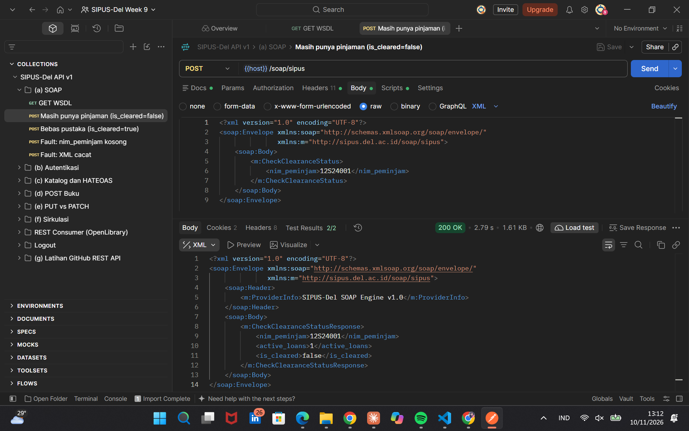

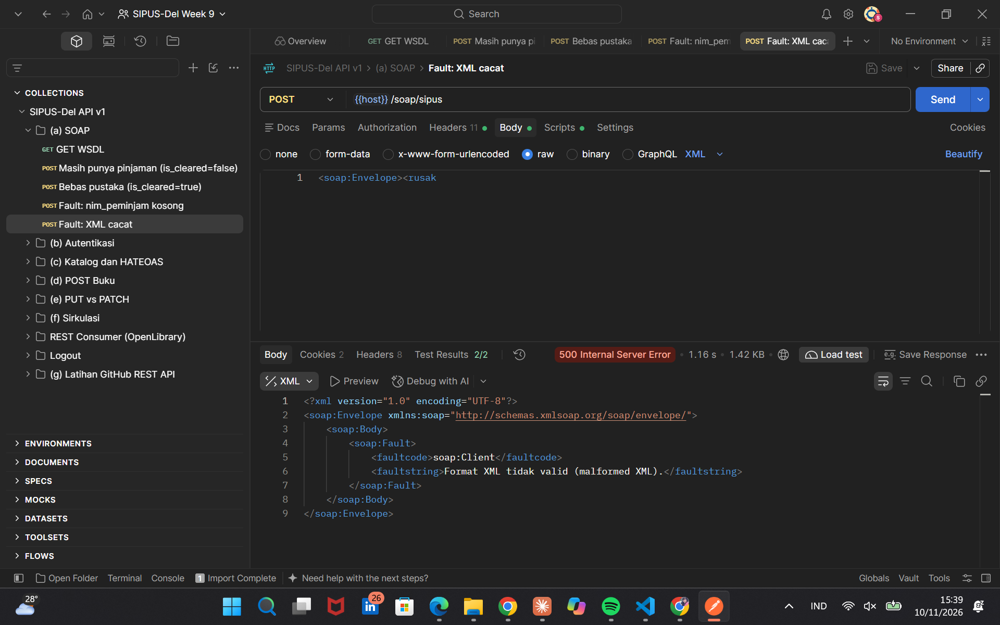

**(b) Login Bearer Token**

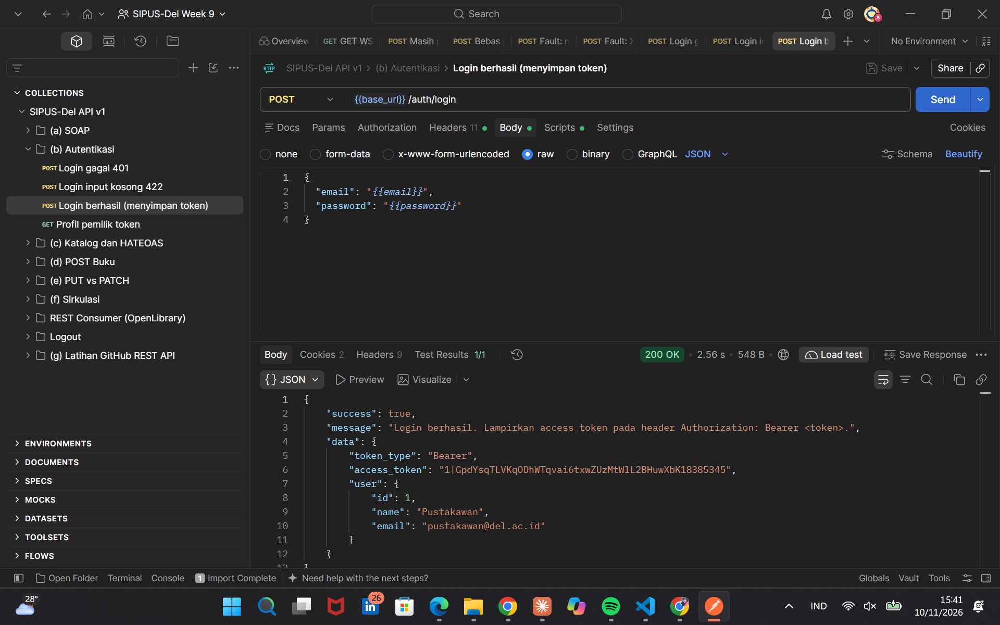

**(c) Katalog terpaginasi dan HATEOAS**

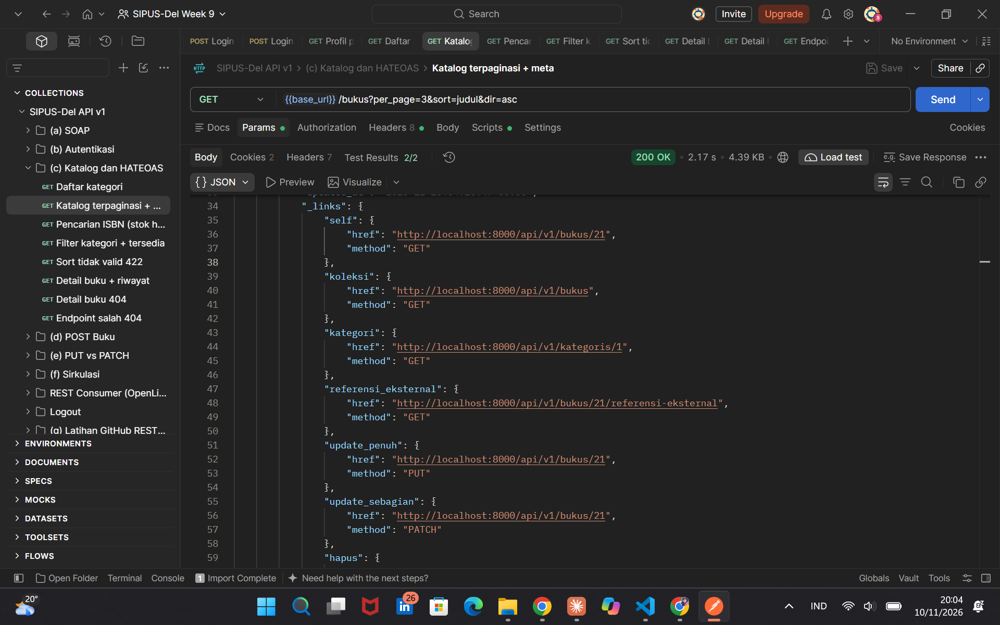

**(d) POST Buku 201 Created dan header Location**

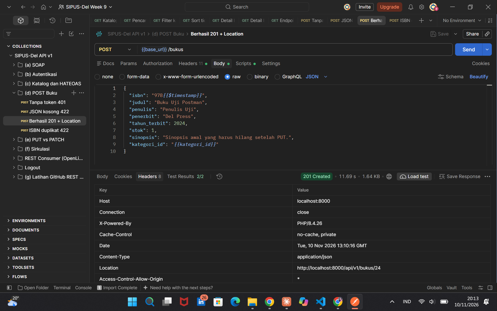

**(e) Perbedaan PUT dan PATCH**

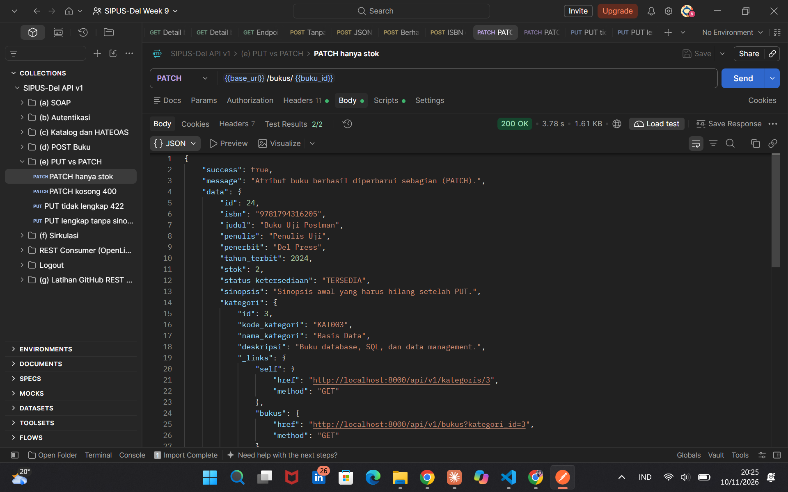

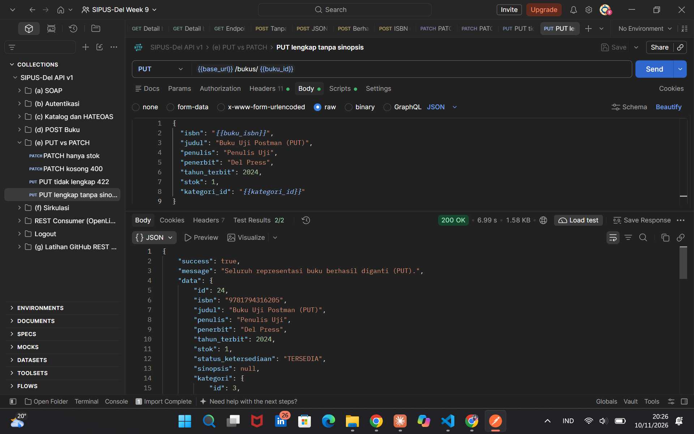

**(f) Peminjaman sukses dan penolakan (422 / 409)**

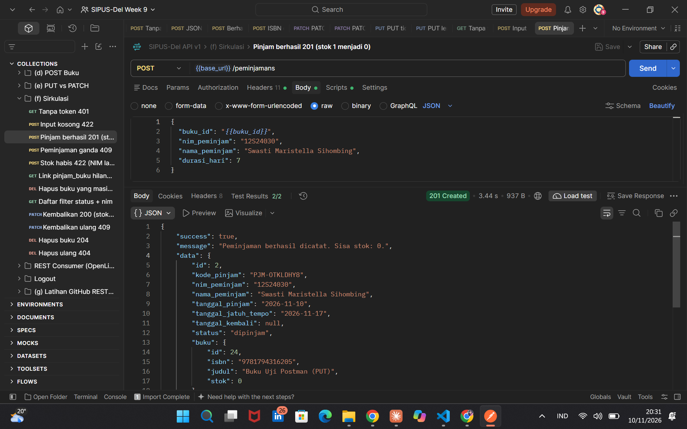

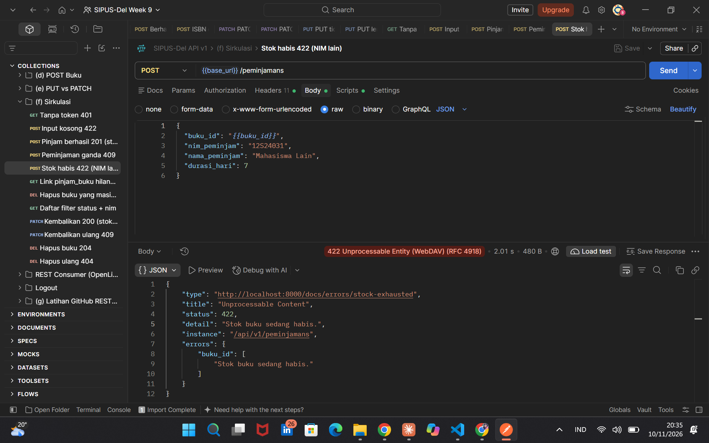

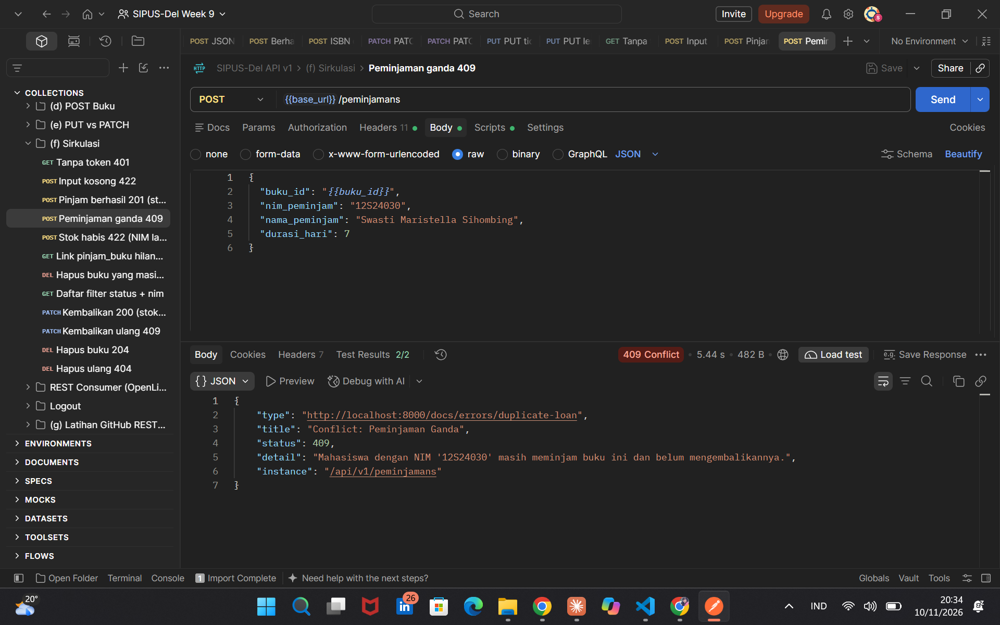

**(g) Latihan GitHub REST API (token disensor)**

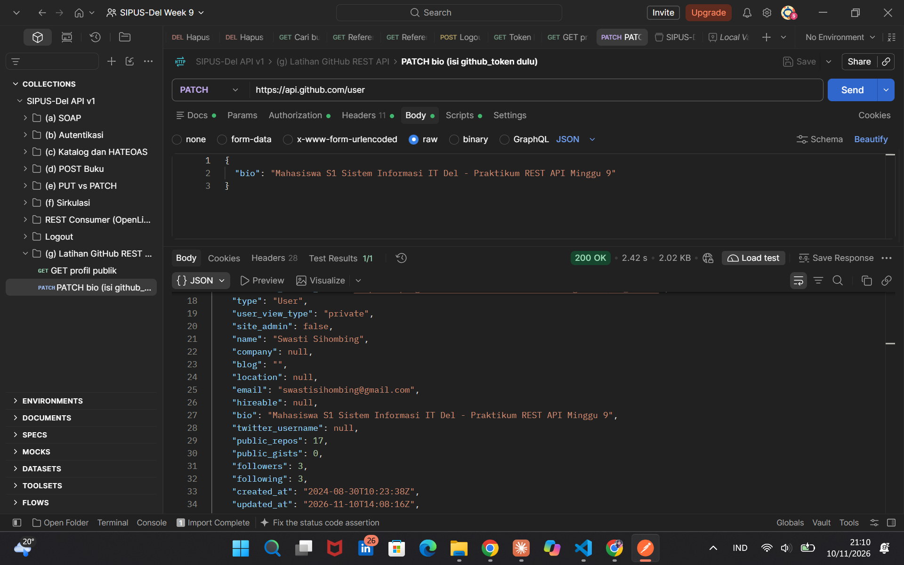

## 6. Keamanan dan Version Control

- File `.env` dan folder `vendor/` tidak diunggah. Gunakan `.env.example`.
- Token GitHub hanya disimpan di variabel lokal Postman, tidak pernah ditulis di kode atau README.
- Commit mengikuti Conventional Commits: `feat(soap)`, `feat(api-core)`, `feat(api-auth)`, `feat(api-books)`, `feat(api-loans)`, `feat(api-consumer)`, `docs(contract)`.
